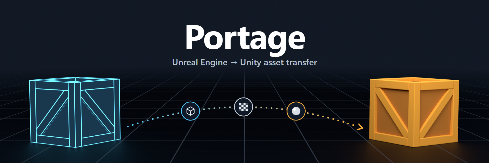

# Portage

Move assets from an Unreal Engine project into Unity.

Portage exports static meshes from the Unreal Editor and rebuilds them in Unity with URP Lit
materials: the mesh at the right size and orientation, its textures, and the parameters of its
material instances.

> **Status: pre-alpha.** Static meshes, textures and material instances work end to end and are
> covered by automated tests. It has only been tried on a handful of assets so far, so expect
> rough edges on real asset packs.

## What gets transferred

| | |
| --- | --- |
| ✅ Static meshes | FBX, 1 Unreal metre = 1 Unity unit, no rotation or scale on the imported model |
| ✅ Textures | PNG, with the right color space; normal maps converted to Unity's convention |
| ✅ Material instances | Rebuilt as URP Lit materials from the instance's parameters, including packed ORM-style masks |
| ⚠️ Materials without parameters | Reported, not converted: their textures live inside the material graph |
| ❌ Not supported | Blueprints, Niagara, complex material graphs, skeletal meshes and animations (planned), levels (planned) |

Materials are not baked. Portage reads the parameters a material exposes (textures, colors,
numbers) and maps them to URP Lit inputs, so anything a master material computes in its graph
(dirt layers, detail normals, tiling) is not reproduced.

## Requirements

| | Version |
| --- | --- |
| Unreal Engine | 5.8 (tested on 5.8.3). Older 5.x versions may work but are untested. |
| Unity | 6.3 (6000.3) with the Universal Render Pipeline |

Portage works on projects opened in the Unreal Editor. Cooked `.pak` content is not supported.

## Quick start

### 1. Export from Unreal

1. Copy the [`Unreal/Portage`](Unreal/Portage) folder into your Unreal project's `Plugins`
   folder and restart the editor. Nothing has to be compiled.
2. Select static meshes in the Content Browser.
3. Choose **Tools > Export Selected to Unity** and pick an output folder.

### 2. Import into Unity

1. In the Package Manager choose **Add package from git URL** and enter:

   ```
   https://github.com/schyro/Portage.git?path=/Unity
   ```

2. Open **Tools > Portage > Import...** and pick the folder you exported to.
3. Check the **Parameter mapping** list and press **Import**.

Portage guesses which Unreal parameter is the base color, the normal map and so on. If a guess
is wrong, change it in the list; your choice is remembered for that export folder.

More detail: [Unreal exporter](Unreal/README.md) · [Unity importer](Unity/README.md)

## How it works

```
Unreal Editor ──(exporter)──► export folder ──(importer)──► Unity project
                               ├─ manifest.json
                               ├─ Meshes/*.fbx
                               └─ Textures/*.png
```

- The **exporter** is a content-only Unreal plugin written in Python.
- The **manifest** records which mesh uses which material, what parameters each material has and
  how each texture must be interpreted. See [Docs/manifest-format.md](Docs/manifest-format.md).
- The **importer** is a Unity package that reads the folder and builds the assets. Your mapping
  choices are stored next to the manifest; see [Docs/mapping-format.md](Docs/mapping-format.md).

## Roadmap

1. LODs, collision and sockets.
2. Skeletal meshes and animation sequences.
3. Level placement as prefabs or scenes.

## Content licensing

Portage is a tool. It does not give you any rights to the content you run it on.

- Use it only on content you are allowed to use outside Unreal Engine.
- Do not transfer content licensed for use in Unreal Engine only, such as legacy "UE-Only"
  content or Epic's sample content (Mannequin, Starter Content).
- Check the license of every asset before moving it. For Fab content see the
  [Fab licenses](https://dev.epicgames.com/documentation/en-us/fab/licenses-and-pricing-in-fab).

This repository contains no Unreal Engine source code and no third-party assets, and
contributions must keep it that way.

## License

[MIT](LICENSE)
